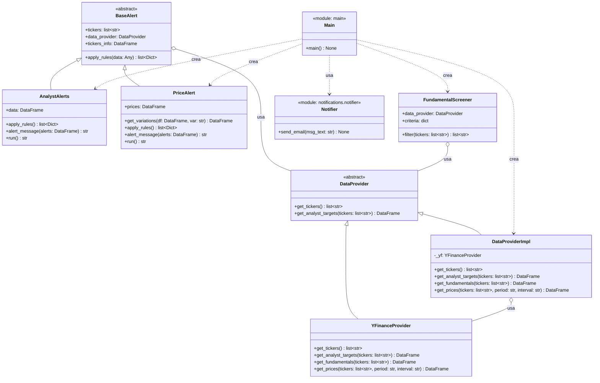

# Diagrama de clases UML

Diagrama de clases del proyecto `stock-alerts`, generado a partir del código en `src/`.

## Notas

- `DataProvider` (`src/providers/base.py`) es el puerto de la arquitectura hexagonal para acceder a datos de mercado. Declara `get_tickers()` y `get_analyst_targets()`; `get_fundamentals()` y `get_prices()` existen en los adaptadores pero todavía no están declaradas en el puerto.
- `DataProviderImpl` (`src/providers/data_provider_impl.py`) implementa `DataProvider` delegando en `YFinanceProvider` para price targets, fundamentales y precios históricos, y lee los tickers desde ficheros JSON locales en `data/tickers/`.
- `YFinanceProvider` (`src/providers/yfinance_provider.py`) es el adaptador concreto hacia la librería `yfinance`; no implementa `get_tickers()`.
- `BaseAlert` (`src/alerts/base_alert.py`) es la clase abstracta base de las alertas: mantiene la lista de tickers, una referencia al `DataProvider` y carga `data/tickers.csv` en `tickers_info` para enriquecer los mensajes con el nombre de la empresa.
- `AnalystAlerts` (`src/alerts/analysts_alert.py`) implementa la regla basada en la diferencia porcentual entre el precio actual y el precio objetivo medio de analistas (alerta si está más de un 10% por debajo).
- `PriceAlert` (`src/alerts/price_alerts.py`) implementa la regla basada en la variación del precio de cierre en distintas ventanas (1M, 3M, 6M, 9M) sobre un histórico de 1 año: alerta si cae más de -5%, -10%, -15% o -20% respectivamente.
- `FundamentalScreener` (`src/screening/fundamental_screener.py`) filtra los tickers antes de las alertas según criterios fundamentales (deuda/equity y márgenes operativos).
- `Notifier` (`src/notifications/notifier.py`) expone `send_email` para notificar las alertas por correo vía SMTP de Gmail.
- `Main` (`src/main.py`) es el punto de entrada que orquesta el flujo: obtiene tickers, aplica el filtro fundamental, ejecuta ambas alertas y envía el email con los dos mensajes concatenados.
