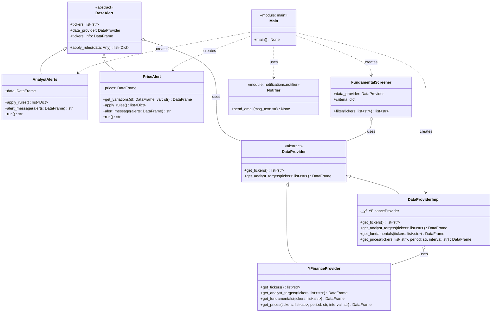

# UML class diagram

Class diagram of the `stock-alerts` project, generated from the code in `src/`.

## Notes

- `DataProvider` (`src/providers/base.py`) is the hexagonal architecture's port for accessing market data. It declares `get_tickers()` and `get_analyst_targets()`; `get_fundamentals()` and `get_prices()` exist in the adapters but are not declared in the port yet.
- `DataProviderImpl` (`src/providers/data_provider_impl.py`) implements `DataProvider` by delegating to `YFinanceProvider` for price targets, fundamentals and historical prices, and reads the tickers from local JSON files in `data/tickers/`.
- `YFinanceProvider` (`src/providers/yfinance_provider.py`) is the concrete adapter towards the `yfinance` library; it does not implement `get_tickers()`.
- `BaseAlert` (`src/alerts/base_alert.py`) is the abstract base class of the alerts: it holds the ticker list, a reference to the `DataProvider`, and loads `data/tickers.csv` into `tickers_info` to enrich the messages with the company name.
- `AnalystAlerts` (`src/alerts/analysts_alert.py`) implements the rule based on the percentage difference between the current price and the analysts' median price target (alerts when it is more than 10% below).
- `PriceAlert` (`src/alerts/price_alerts.py`) implements the rule based on the closing price variation over several windows (1D, 1W, 1M, 3M, 6M, 9M, 1Y), measured in calendar time against the last price: it alerts on drops beyond -5%, -5%, -5%, -10%, -15%, -20% and -15% respectively.
- `FundamentalScreener` (`src/screening/fundamental_screener.py`) screens the tickers before the alerts according to fundamental criteria (debt/equity and operating margins).
- `Notifier` (`src/notifications/notifier.py`) exposes `send_email` to notify the alerts by email through Gmail's SMTP server.
- `Main` (`src/main.py`) is the entry point that orchestrates the flow: it fetches tickers, applies the fundamental screen, runs both alerts and sends the email with the two messages concatenated.
